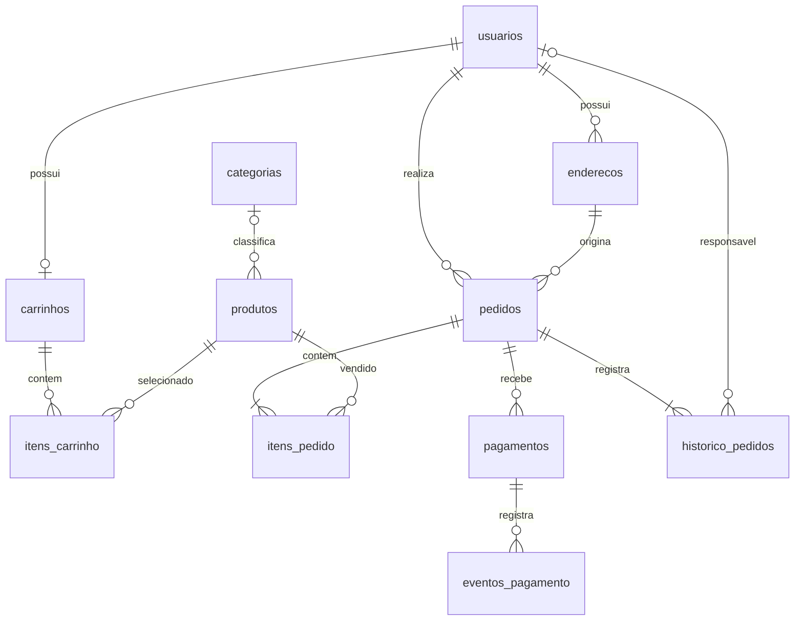

# Doce Ateliê — Aplicação web de cupcakes gourmet

Projeto acadêmico de Engenharia de Software para uma loja de cupcakes gourmet, desenvolvido com HTML, CSS, JavaScript, Node.js e PostgreSQL. Reúne análise de requisitos, UML, projeto de dados, protótipo navegável e uma API de leitura integrada ao banco.

O objetivo é permitir que clientes encontrem produtos, confiram informações alimentares, façam pedidos e acompanhem o atendimento. A implementação atual valida o design e a estrutura técnica; o checkout e os pagamentos ainda são demonstrativos.

## Para tutores e avaliadores

| Entrega | Onde revisar |
| --- | --- |
| Situação 1 — revisão de escopo, UML, IHC e dados | [Relatório consolidado](public/revisao.html), servido em `/revisao.html` |
| Diagramas UML editáveis | [Fontes PlantUML](docs/modelos-revisados.puml) |
| Projeto conceitual de dados | [Fonte Mermaid](docs/projeto-conceitual.mmd) |
| Wireframes e mapas de interface | [Documento de design](public/design.html), servido em `/design.html` |
| Protótipo de interface | [Código da interface](public/), servido em `/` |
| Estrutura PostgreSQL | [Script SQL](database/001_schema.sql) |
| Testes da lógica do protótipo | [Testes automatizados](tests/prototipo.test.js) |
| Situação 2 — versionamento e publicação | [Guia de publicação](docs/publicacao-github.md) |

O GitHub exibe o código dos arquivos HTML; para visualizar a interface e os diagramas renderizados, execute o projeto localmente seguindo as instruções abaixo.

### Estado das funcionalidades

- **Implementado:** servidor de arquivos, conexão PostgreSQL, consulta de produtos, diagnóstico do banco, esquema relacional e auditoria de leitura.
- **Demonstrativo:** sacola, acesso, cadastro, entrega, checkout, pagamento, acompanhamento e operação, com dados em memória.
- **Pendente:** autenticação real, persistência dos fluxos de compra, controle transacional de estoque, integração de pagamento, expiração agendada e publicação da aplicação.

### Como verificar

```powershell
npm ci
npm run check
npm test
```

Esses testes não dependem do PostgreSQL. Para iniciar a aplicação, configure o banco e o `.env` conforme as seções seguintes. As verificações automatizadas não representam uma auditoria visual ou de acessibilidade.

### Organização do repositório

```text
database/    Esquema, exemplos e auditoria SQL
docs/        Fontes dos modelos e guia de publicação
public/      Interface, wireframes, mapas e relatório consolidado
src/         Servidor HTTP e conexão PostgreSQL
tests/       Testes da lógica demonstrativa
tools/       Geração do relatório e auditoria do banco
```

## Base técnica

Base para a aplicação web em HTML, CSS e JavaScript, com servidor Node.js e PostgreSQL. A entrega inclui o esquema SQL, uma API local de leitura e um protótipo navegável de interface. Cadastro, autenticação, checkout, pagamentos e administração reais ainda precisam ser implementados.

## Arquitetura

Navegador (HTML/CSS/JS) → API Node.js → PostgreSQL.

O servidor entrega o protótipo em `/`, os mapas e wireframes em `/design.html` e respostas JSON nas rotas `/api`. O catálogo do protótipo usa dados fictícios em memória, independentes do banco. A consulta real ao catálogo continua disponível em `/api/produtos`. Credenciais do PostgreSQL ficam somente no servidor.

## Entrega de design da interface

Depois de iniciar o servidor, abra `http://localhost:3001/` para o mockup navegável e `http://localhost:3001/design.html` para os 12 wireframes, o mapa conceitual e o mapa de navegação. A página de design tem a opção de imprimir ou salvar em PDF pelo navegador.

## Situação 1 e revisão do planejamento

O relatório consolidado está em `http://localhost:3001/revisao.html`, com opção de impressão/PDF. Ele contém escopo, plano de incrementos, oito casos de uso revisados, diagramas UML de casos de uso, classes de persistência, sequência e atividades, revisão da IHC, modelo conceitual e projeto lógico normalizado, rastreabilidade e critérios de validação.

As fontes editáveis dos diagramas estão em `docs/modelos-revisados.puml` e `docs/projeto-conceitual.mmd`. Os SVGs do relatório são gerados localmente por `npm run docs:revisao`, sem depender de serviços externos. O relatório é a referência consolidada desta revisão; `Artefatos_UML_Cupcakes.html` foi preservado como versão inicial histórica.

O protótipo revisado permite sacola visitante, indisponibilidade, validação explícita de endereço, edição de estoque/informações alimentares, criação de pedido antes do pagamento, recusa preservando o mesmo pedido, aprovação idempotente e expiração liberando a reserva. Produtos, pedidos e reservas continuam exclusivamente em memória. O cupcake de morango começa com estoque zero; altere o estoque na operação para testá-lo. O CEP `00000000` simula área não atendida. A demonstração mostra somente o pedido mais recente.

Na revisão dos dados, o núcleo lógico 3FN distingue atributos derivados das decisões do esquema físico. O banco existente mantém redundâncias controladas como `pedidos.usuario_id`, `pedidos.subtotal`, `produtos.estoque_reservado` e `pagamentos.valor`; o relatório descreve as dependências e os controles. Nenhuma tabela precisa ser recriada nesta etapa.

Execute `npm run audit:db` para uma auditoria de leitura da estrutura e das invariantes; ou abra `database/auditoria.sql` no pgAdmin. A execução desta revisão encontrou 11 tabelas e zero divergências nas quatro consultas. Isso não comprova concorrência ou integridade de fluxos que ainda não foram implementados no backend.

O fluxo de demonstração é: catálogo → detalhe → sacola → acesso simulado → entrega → revisão → pedido reservado e pagamento simulado → acompanhamento. O rodapé dá acesso à operação da loja, onde é possível avançar o andamento e editar nome, preço, estoque, ingredientes, alergênicos e situação ativa de produtos fictícios. Todas as alterações são reiniciadas ao recarregar a página. Não use dados pessoais reais.

Os arquivos estão em `public/`. Não há gravações no banco durante o uso do protótipo. A marca Doce Ateliê é uma proposta para validação, assim como os preços e as condições de entrega. As telas de acesso não pedem senha nesta fase.

Execute `npm test` para verificar os fluxos simulados e `npm run check` para verificar a sintaxe. A revisão visual automatizada não foi realizada porque o host de acesso ao navegador estava indisponível; revise desktop, celular, teclado e impressão antes da apresentação final.

## Modelo relacional

| Tabela | Responsabilidade |
| --- | --- |
| usuarios | Clientes e funcionários; senha em hash e papel de acesso |
| enderecos | Endereços pertencentes a cada usuário |
| categorias | Agrupamento opcional de produtos |
| produtos | Catálogo, preço, ingredientes, alergênicos e estoque |
| carrinhos | Um carrinho por usuário |
| itens_carrinho | Produtos e quantidades; não reserva estoque |
| pedidos | Compra, situação, endereço congelado e valores |
| itens_pedido | Quantidade, nome e preço congelados da compra |
| pagamentos | Tentativas de pagamento vinculadas ao pedido |
| eventos_pagamento | Registro de eventos externos para processamento idempotente |
| historico_pedidos | Evolução do atendimento e responsável |



As cardinalidades mínimas de um item e um histórico por pedido são regras do checkout transacional; chaves estrangeiras isoladas não garantem esses mínimos. IDs inteiros simplificam esta implementação em relação aos UUIDs do modelo conceitual. As chaves de idempotência continuam UUIDs, geradas no Node com `crypto.randomUUID()`.

## Como executar localmente

Requisitos: Node.js 22 ou superior e PostgreSQL 16 ou superior, com `psql` disponível. Pode usar o Query Tool do pgAdmin no lugar dos comandos `psql`, abrindo os arquivos SQL no banco indicado.

1. No `psql`, conectado como administrador ao banco `postgres`, crie um usuário local e o banco:

```sql
CREATE ROLE cupcakes_app LOGIN;
```

Use `\password cupcakes_app` no **psql** para definir a senha sem escrevê-la em um script. No pgAdmin, defina a senha na criação do Login/Group Role.

```sql
CREATE DATABASE cupcakes OWNER cupcakes_app;
```

Execute `CREATE DATABASE` fora de um bloco de transação. Este usuário proprietário serve ao desenvolvimento local; em produção, separe usuário de migração do usuário da API e dê somente os privilégios necessários.

Se você já criou as tabelas em outro banco, use seu nome em `PGDATABASE` no `.env`. Não crie outro banco nem reaplique o esquema em uma instalação já configurada.

2. No terminal, na pasta do projeto, crie as tabelas e, opcionalmente, o catálogo fictício:

```powershell
psql -h localhost -U cupcakes_app -d cupcakes -v ON_ERROR_STOP=1 -f database/001_schema.sql
psql -h localhost -U cupcakes_app -d cupcakes -v ON_ERROR_STOP=1 -f database/002_dados_exemplo.sql
```

O esquema e os exemplos são migrações de execução única; não reaplique em um banco já inicializado. Novas alterações devem entrar em novos arquivos numerados. Nenhum script apaga tabelas existentes.

3. Configure e inicie a API:

```powershell
Copy-Item .env.example .env
# Edite .env com a senha definida no PostgreSQL.
npm install
npm run check
npm start
```

4. Abra `http://127.0.0.1:3001/api/saude`, `http://127.0.0.1:3001/api/produtos` ou `http://127.0.0.1:3001/api/produtos?busca=chocolate`.

## Decisões e garantias do banco

- Dinheiro em `numeric`, sem ponto flutuante. O driver `pg` devolve `numeric` como string para preservar precisão; não converta valores financeiros para `Number` para fazer contas de checkout.
- Datas em `timestamptz`; a interface formata em `America/Sao_Paulo`.
- E-mail normalizado em minúsculas e único. A validação SQL é básica; o servidor também valida o formato e a normalização.
- Quantidades positivas; estoque reservado não supera estoque físico; disponibilidade calculada pelo banco.
- Produto e endereço usados em pedidos são preservados. Use `ativo = false` para desativar; não apague registros comerciais.
- Nome e preço do item, bem como endereço de entrega, são copiados no fechamento. O cliente continua vendo os dados da compra mesmo após mudanças cadastrais.
- Chaves únicas impedem repetição do pedido por idempotência e mais de uma tentativa liquidada por pedido. Nenhum dado completo de cartão deve ser gravado.
- A chave estrangeira composta garante que o endereço de origem pertença ao dono do pedido. Autorização de leitura e papel de funcionário precisam ser verificados no servidor.
- `atualizado_em` e `versao` são atualizados explicitamente pela aplicação; não há triggers automáticos nesta versão.

## Regras a implementar no servidor antes de vender

O esquema não executa sozinho os fluxos comerciais. Use o helper `transaction` de `src/db.js` para manter todas as consultas de cada transação na mesma conexão.

### Fechamento do pedido

1. Autenticar o cliente; obter `usuario_id` da sessão, nunca confiar no ID informado pelo navegador.
2. Iniciar transação e bloquear o carrinho com `SELECT ... FOR UPDATE`. Todas as alterações de carrinho devem usar o mesmo bloqueio. Procurar pedido pela chave de idempotência; se existir e pertencer ao cliente, retornar esse pedido.
3. Bloquear os produtos em ordem crescente de ID com `FOR UPDATE`, para reduzir deadlocks. Revalidar produtos ativos, quantidades, preços, área e taxa de entrega; se o resumo mudou, pedir confirmação novamente.
4. Reservar estoque, copiar o endereço e inserir pedido, itens e primeiro histórico. Somar os itens no servidor/banco e gravar exatamente esse subtotal; nunca aceitar o total enviado pelo navegador.
5. Esvaziar o carrinho e confirmar a transação. Se houver erro, fazer rollback de tudo. Tratar conflito de chave de idempotência recuperando o pedido existente com checagem de propriedade.
6. Solicitar a cobrança fora da transação, com chave estável por tentativa. Registrar a tentativa antes de chamar o provedor e permitir recuperação após timeout. Não manter bloqueios do banco esperando uma chamada de rede.

Exemplo da atualização de reserva, dentro da transação (verifique se `rowCount === 1`):

```sql
UPDATE produtos
   SET estoque_reservado = estoque_reservado + $1
 WHERE id = $2 AND ativo = true
   AND disponivel >= $1
RETURNING id;
```

### Pagamento e expiração

Validar a assinatura do webhook e conferir valor, moeda e referência no provedor. Na transação, bloquear primeiro o pedido e depois os produtos em ordem de ID; usar essa mesma ordem no processo de expiração. Registrar o identificador do evento e ignorar repetições. Conferir que a tentativa pertence ao pedido e que seu valor coincide com o total.

Se a aprovação for válida antes do vencimento, diminuir `estoque_fisico` e `estoque_reservado` pela mesma quantidade, marcar o pagamento aprovado, mudar o pedido para confirmado e registrar histórico, na mesma transação. Se a reserva venceu, cancelar/liberar uma única vez e conciliar o estorno de eventual aprovação tardia. Uma tarefa agendada deve executar a expiração dos pedidos pendentes. Nenhum agendador ou integração de pagamento está implementado nesta entrega.

### Operação da loja

Somente funcionário autorizado pode avançar `confirmado → em_preparo → saiu_para_entrega → entregue`. `aguardando_pagamento → confirmado` depende da aprovação verificada; `aguardando_pagamento → cancelado` ocorre pela expiração. O `CHECK` limita os nomes de status; a aplicação ainda precisa validar as transições, incrementar `versao` e inserir o histórico na mesma transação.

Cadastro usa hash de senha apropriado (por exemplo, Argon2id ou scrypt), sem gravar senha em texto. O endpoint público não aceita o papel `funcionario`. A camada de sessão/autenticação ainda deve ser construída.

## Verificação

`npm run check` verifica a sintaxe JavaScript. A execução real do SQL e a conexão precisam ser verificadas com PostgreSQL disponível. Depois, testar duas compras concorrentes da última unidade, reenvio de checkout, webhook duplicado e disputa entre aprovação e expiração; esses cenários validam as regras transacionais que serão implementadas.

## Referências técnicas

- PostgreSQL: https://www.postgresql.org/docs/current/ddl-constraints.html
- Consultas parametrizadas: https://node-postgres.com/features/queries
- Transações na mesma conexão: https://node-postgres.com/features/transactions
